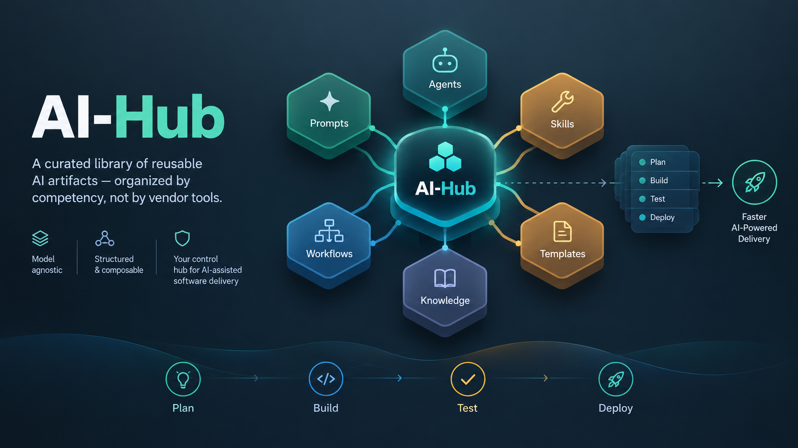

# AI-Hub

AI-Hub is a curated collection of AI artifacts, patterns, and frameworks focused on competency, not tools.

**Start here:** [AI.md](AI.md) — canonical entry point for repository structure, metadata conventions, and contribution rules.

## Browse

| Folder | What lives here |
| --- | --- |
| [skills/](skills/README.md) | Atomic capabilities and techniques |
| [prompts/](prompts/README.md) | Prompt patterns and reusable task setups |
| [workflows/](workflows/README.md) | Multi-step execution patterns |
| [knowledge/](knowledge/README.md) | Stable concepts, glossaries, and shared contracts |
| [templates/](templates/README.md) | Starter files for new artifacts |

## Quick links

- [Safety policy](knowledge/safety-policy.md) — operational guardrails for every prompt and skill
- [Project evaluation](prompts/project-evaluation.md) — Principal-Engineer codebase audit across 14 criteria
- [Story completion evaluation](prompts/story-development-completion-evaluation.md) — is the story implemented, and is every criterion met
- [Bug fix diagnosis and resolution](prompts/bug-fix-diagnosis-and-resolution.md) — triage, root cause, gated fix
- [Repository knowledge graph creation](prompts/repository-knowledge-graph-creation.md) — build a `kb/` knowledge graph so agents can navigate any repository

## Tool adapters

Thin, tool-specific adapters — they point back to [AI.md](AI.md) and must not become alternate sources of truth:

- [`.cursor/rules/ai-hub.mdc`](.cursor/rules/ai-hub.mdc) — Cursor entry rule
- [`.coding-assistant/instructions.md`](.coding-assistant/instructions.md) — generic coding-assistant adapter
- [`.coding-assistant/context.md`](.coding-assistant/context.md) — short purpose context
