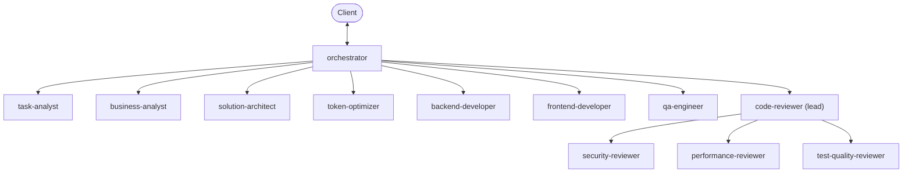

[Home](../README.md) · [AI.md](../AI.md) · [Agents](./README.md) · [Skills](../skills/README.md) · [Prompts](../prompts/README.md) · [Workflows](../workflows/README.md) · [Knowledge](../knowledge/README.md) · [Templates](../templates/README.md)

# Agents

Principal-level role definitions for the orchestrated delivery team: one role per file, each with its expertise, operating modes, quality bar, escalation rules, and return package. The definitions are executor-agnostic; adapters point at them.

New agents: copy [../templates/agent-template.md](../templates/agent-template.md).

## Delivery roles

| Agent | Role | Capabilities | Effort |
| --- | --- | --- | --- |
| [orchestrator-agent.md](./orchestrator-agent.md) | Owns the request end to end: triage, delegation, gates, verification routing, final report. The only role that talks to the client | read, delegate, ask | deep |
| [task-analyst-agent.md](./task-analyst-agent.md) | Classifies and decomposes the request, sizes it, recommends the lightest sufficient path | read | standard |
| [business-analyst-agent.md](./business-analyst-agent.md) | Story, acceptance criteria `AC-1…n`, per-criterion feasibility, open questions | read | standard |
| [solution-architect-agent.md](./solution-architect-agent.md) | Design, contracts, work packages with owned paths, test strategy; bug diagnosis | read | deep |
| [token-optimizer-agent.md](./token-optimizer-agent.md) | Budgets, context packs, artifact token audits | read | light |
| [backend-developer-agent.md](./backend-developer-agent.md) | Implements one backend package with unit tests | read, edit, run | standard |
| [frontend-developer-agent.md](./frontend-developer-agent.md) | Implements one UI package with component tests, against the agreed contract | read, edit, run | standard |
| [qa-engineer-agent.md](./qa-engineer-agent.md) | Authors acceptance tests, then verifies completion independently | read, edit, run | standard |

## Review panel

The lead triages each change set and runs only the specialists the diff needs, in parallel, then merges one verdict. Where the executor cannot delegate, the lead returns a `panel_request` and the orchestrator runs the specialists instead — a weaker runtime costs a round trip, never a skipped review.

| Agent | Surface | Capabilities | Effort |
| --- | --- | --- | --- |
| [code-reviewer-agent.md](./code-reviewer-agent.md) | Lead: correctness, design fit, scope drift, routing, merged verdict | read, run, delegate | deep |
| [security-reviewer-agent.md](./security-reviewer-agent.md) | Trust boundaries, authorization, injection, secrets, supply chain | read, run | deep |
| [performance-reviewer-agent.md](./performance-reviewer-agent.md) | Complexity, I/O and query patterns, allocation, concurrency, caching | read, run | deep |
| [test-quality-reviewer-agent.md](./test-quality-reviewer-agent.md) | Assertion strength, criterion coverage, seams, flakiness | read, run | standard |

## How the team works

- Hub and spoke: only the orchestrator talks to the client. A specialist is dispatched by the orchestrator or by the panel lead, and reports only to whoever dispatched it.
- Contracts are fixed before parallel work starts; packages that run in parallel own disjoint paths.
- Context travels as pointers, not pasted file bodies, and budgets carry explicit stop rules.
- Verification is independent: verifiers get the criteria and the diff, never the implementer's narrative.
- Rework is bounded; after two failed rounds on one issue the run replans or escalates.

Rules: [../knowledge/orchestrated-delivery-protocol.md](../knowledge/orchestrated-delivery-protocol.md). Sequence: [../workflows/orchestrated-delivery.md](../workflows/orchestrated-delivery.md). Guardrails: [../knowledge/safety-policy.md](../knowledge/safety-policy.md) and [../knowledge/scoped-context-discipline.md](../knowledge/scoped-context-discipline.md).

## Skill binding

Each agent lists its default skills. The orchestrator's dispatch packet carries a `SKILLS` key that adds the task-specific ones — typically the stack skills for a work package. Specialists load only what the packet names; see [../skills/README.md](../skills/README.md).

## Adapters

The definitions here are the single source of truth. An adapter carries only the routing and permission fields its tool needs, plus a pointer to the role file, and is the only place an absolute hub path appears. Permissions are derived from each agent's `capabilities`:

| Capability | Adapter effect |
| --- | --- |
| no `edit-files` | Read-only enforcement: a read-only flag, a read-only tool allowlist, or an explicit instruction, depending on the tool |
| `run-commands` | Shell tools added to the allowlist |
| `delegate` | Agent-spawning tool added to the allowlist |
| `ask-user` | Role runs in the main conversation rather than as a delegated agent |

Adapter folders: `.cursor/agents/`, `.claude/agents/`, `.codex/agents/`, and the `orchestrate` entry skill under `.claude/skills/` and `.agents/skills/`. Keep them thin; never let one become a second role definition.

---

[↑ Back to AI-Hub](../README.md)
