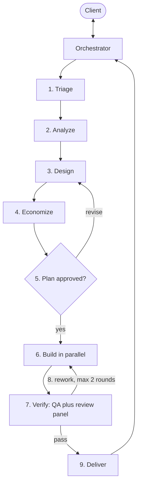

# Orchestrated Delivery

## Summary

The sequence the team in [../agents/README.md](../agents/README.md) follows from a client request to a delivered change. The orchestrator owns the sequence and the client relationship; each specialist owns one step. The run is sized to the request first, so a question never pays for a full delivery cycle.

## Use When

- A request needs more than one competency, or needs verification independent of whoever implements it.
- Work must be split across roles that cannot negotiate with each other mid-task.
- A change needs a client decision before anything is written.

## Roles

| Role | Responsibility in this workflow |
| --- | --- |
| [orchestrator-agent.md](../agents/orchestrator-agent.md) | Owns the sequence, dispatches every step, is the only contact with the client |
| [task-analyst-agent.md](../agents/task-analyst-agent.md) | Triage: classifies the request, decomposes it, recommends the path |
| [business-analyst-agent.md](../agents/business-analyst-agent.md) | Story, acceptance criteria, feasibility |
| [solution-architect-agent.md](../agents/solution-architect-agent.md) | Design, contracts, work packages; bug diagnosis |
| [token-optimizer-agent.md](../agents/token-optimizer-agent.md) | Budgets and context packs for the steps that follow |
| [backend-developer-agent.md](../agents/backend-developer-agent.md) · [frontend-developer-agent.md](../agents/frontend-developer-agent.md) | Implement one work package each |
| [qa-engineer-agent.md](../agents/qa-engineer-agent.md) | Authors acceptance tests, then verifies independently |
| [code-reviewer-agent.md](../agents/code-reviewer-agent.md) | Review lead; runs the specialist panel and merges one verdict |

## Inputs

- Required: a client request, and a target project the specialists can read.
- Optional: existing acceptance criteria; architectural constraints and priorities; repository knowledge files — `AGENTS.md` and `AI.md` per project, and a `kb/` graph — from [../prompts/repository-knowledge-graph-creation.md](../prompts/repository-knowledge-graph-creation.md).

## Routing

Step 1 decides the path. Running steps a request does not need is the most common way this workflow wastes effort.

| Request | Path |
| --- | --- |
| Question or investigation | Step 1, then the orchestrator answers or dispatches one read-only investigation. No build, no panel. |
| Bug | Steps 1, 3 (diagnose), 5, 6, 7, 9 |
| Small change: one layer, few files, no safety flags | Steps 1, 5, 6, 7, 9 — the orchestrator writes 1–3 criteria itself at Step 1 |
| Feature or story | All steps |
| Unfamiliar or large repository | Add Step 4 to any path above |

## Steps

1. **Triage.** Task analyst. In: the client request. Out: classification, decomposition, recommended path, blocking questions. Exit: the orchestrator has a brief it can route, with material ambiguity resolved by the client.
2. **Analyze.** Business analyst. In: the brief. Out: story, `AC-1…n`, per-criterion feasibility. Exit: criteria are stable and no question blocks. A `NOT_FEASIBLE` verdict ends the run at Step 9.
3. **Design.** Solution architect. In: approved criteria, or a bug report in diagnose mode. Out: contracts, work packages with owned paths, test strategy, safety flags. Exit: every criterion maps to a package and a test, parallel packages own disjoint paths, and contracts precede their consumers.
4. **Economize.** Token optimizer. In: the plan and the repository. Out: a budget per step and a context pack per package. Exit: each downstream packet can carry pointers instead of file bodies. Skip for small, familiar work.
5. **Plan gate.** Orchestrator and client. In: criteria, approach, packages, safety flags. Out: approval, revision, or stop. Exit: the client has approved. Nothing is written before this.
6. **Build.** Developers in parallel where paths are disjoint; QA authors acceptance tests alongside, from the criteria only. In: one work package each. Out: implementation, tests, real command results, criterion-to-evidence map. Exit: every package returns `done`, `blocked`, or `failed`.
7. **Verify.** QA verification and the review panel, in parallel. In: criteria, plan, changed-file list, commands — never the implementers' narrative. Out: a `PASS`/`FAIL` verdict with evidence, and one merged `APPROVE`/`CHANGES_REQUESTED` with findings. Exit: both verdicts are in.
8. **Rework.** Orchestrator classifies the outcome, then returns findings to the specialist that produced the work. Out: corrected work. Exit: Step 7 passes, or the loop limit is reached and the run replans or escalates.
9. **Deliver.** Orchestrator. Out: the final report. Exit: the client has the outcome, the evidence, and the open items.

## Checkpoints

- **Step 5 is a hard gate.** No file is written until the client approves the plan.
- Every safety flag — destructive operations, secrets, IAM or infrastructure, public contracts, migrations, new dependencies — is surfaced as a client decision at Step 5, or the moment it is discovered.
- After two failed rework rounds on the same issue, the client decides.
- Only the client may waive a checkpoint, and only for the current task.

## Failure Handling

| Situation | Response |
| --- | --- |
| Blocking question at any step | Orchestrator asks the client, then re-dispatches the same step with the answer |
| Specialist returns `blocked` | Orchestrator supplies the missing input, re-scopes the package, or escalates; it never widens the specialist's paths for it |
| Verification `FAIL` or review `CHANGES_REQUESTED` | Step 8, findings only, to the specialist that produced the work |
| Same issue survives two rework rounds | Stop reworking: back to Step 3, or to the client |
| Cause is the design, not the implementation | Back to Step 3 immediately; rework rounds cannot fix a planning defect |
| Criteria and verification rules are jointly unsatisfiable | Do not dispatch Step 6; resolve at Step 3 or with the client |

## Outputs

- Approved acceptance criteria with stable `AC-1…n` IDs.
- Implemented change inside the approved owned paths, with tests.
- Verification evidence: command results, criterion-to-evidence map, merged review verdict.
- Final report in the shape defined by [../knowledge/orchestrated-delivery-protocol.md](../knowledge/orchestrated-delivery-protocol.md).

## Related

- [../knowledge/orchestrated-delivery-protocol.md](../knowledge/orchestrated-delivery-protocol.md) — packets, returns, budgets, and loop limits this sequence relies on.
- [../agents/README.md](../agents/README.md) — the roles and the review panel.
- [../prompts/README.md](../prompts/README.md) — single-assistant runs, when a full team is unnecessary.

## Safety

- Follow [../knowledge/safety-policy.md](../knowledge/safety-policy.md) and [../knowledge/scoped-context-discipline.md](../knowledge/scoped-context-discipline.md). Do not restate their clauses.
